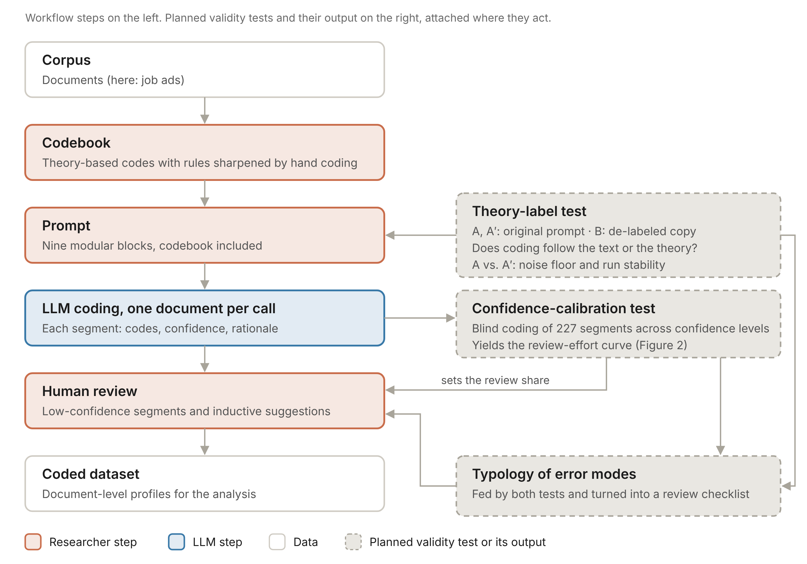

# 00 Workflow overview

This guide follows Figure 1. Each step names what researchers decide, what the LLM does, and which file in this repository supports the step. `decisions.md` collects the choices that have more than one defensible answer.

## Who does what

| Step | Researchers | LLM | Support |
|---|---|---|---|
| 1 Corpus | define the population, collect documents, check integrity | none | `01_corpus.md` |
| 2 Codebook | derive codes from theory, sharpen rules by hand coding | none | `02_codebook.md`, `codebook/template.csv` |
| 3 Prompt | assemble the nine blocks, choose worked examples | none | `03_prompt.md`, `prompts/template/`, `tools/assemble_prompt.py` |
| 4 Coding | choose model and settings, run, check outputs | codes one document per call, returns segments, codes, confidence, rationale | `04_coding.md`, `tools/run_coding.py` |
| 5 Review | review low-confidence segments and inductive suggestions, decide on new codes | none | `05_review.md`, `templates/` |
| 6 Coded dataset | aggregate to document-level profiles, interpret | none | `08_reporting.md` |

The two validity tests sit beside the pipeline and check what the human checkpoints rely on:

- The **theory-label test** (`06_theory_label_test.md`) checks the prompt: does coding follow the text or the theoretical framing?
- The **confidence-calibration test** (`07_calibration_and_curve.md`) checks the review step: does model confidence point to errors, and how much review reaches a target level of agreement?

Both tests feed a **typology of error modes**, which becomes a checklist for human review.

## Principles

1. **Researchers own the instrument.** The codebook, the coding rules and the interpretation stay with the research team. The LLM applies them.
2. **One document per call.** Each call sees one complete document and the full codebook. This keeps calls independent and outputs traceable, but the model cannot compare documents (see `05_review.md` on inductive suggestions).
3. **Archive everything.** Keep every raw response, the prompt hash, the model ID and the settings. Models are retired, and some no longer accept a temperature setting, so report test-retest stability instead of claiming determinism.
4. **Validate where the workflow relies on the model.** Agreement on a calibration set is necessary but does not show whether coding follows theory labels or whether confidence tracks errors.
5. **Fix decisions before you look.** Write thresholds, samples and seeds down, with a date, before the runs (`case/preregistration/` shows our version).

## Minimal path for a new study

1. Fill `codebook/template.csv` and the blocks in `prompts/template/`; run `tools/assemble_prompt.py`.
2. Hand-code a calibration set, revise the rules, keep the calibration documents apart from any validation sample.
3. Estimate cost (`tools/estimate_cost.py`), then run `tools/run_coding.py` on a few documents with `--dry-run`, then on all.
4. Review flagged outputs, low-confidence segments and inductive suggestions.
5. Run both validity tests, or at least the confidence-calibration test, and report as in `08_reporting.md`.
